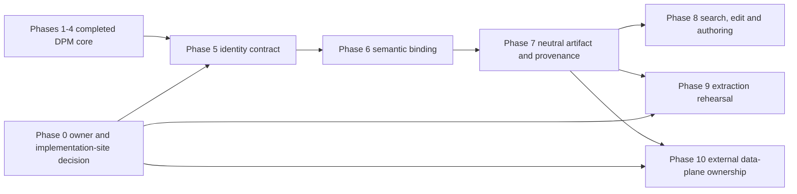

# DPM Master Roadmap — Capability and Gap Alignment

**Status: planning baseline 2026-07-15; private owner CI verification passed**

> Relationship-first baseline: [Goal 4](https://github.com/mineclover/oa-sdk/blob/main/docs/internal/goals/goal-4-dpm-relationship-first-roadmap.md)<br>
> Control-plane runtime/storage baseline: [Goal 5](https://github.com/mineclover/oa-sdk/blob/main/docs/internal/goals/goal-5-dpm-runtime-storage-integration.md)<br>
> Current gap goal: [Goal 68](./goal-68-dpm-logical-data-definition-boundary.md)<br>
> Package boundary: [Package Architecture](../architecture/packages.md)

## Executive state

DPM의 relationship governance loop은 Goal 4~67을 통해 구현되어 있다. 현재 남은 핵심 contract
gap은 “논리 데이터 정의가 없다”가 아니라, 이미 존재하는 logical entity/relationship와
API artifact, DB catalog object를 독립 identity로 연결하고 그 binding을 semantic
validation과 compiled provenance에 반영하는 층이다.

전체 제품 목적은 contract에서 끝나지 않는다. 스펙 관리, 고유 키 관리, 검색, 편집,
작성 편의성을 완성하려면 stable identity와 neutral artifact 위에 read model과
draft/edit/publish workflow를 제공하는 control-plane capability가 추가로 필요하다. 이
capability는 Goal 68의 contract boundary와 구분하며, owner 결정 전에 active feature goal로
취급하지 않는다.

현재 상태를 한 줄로 요약하면 다음과 같다.

```text
relationship-first DPM core       = implemented and tested
logical data/API/DB shape         = v1.1 identity, semantic binding, and neutral artifact implemented
ownership and implementation site = private external owner candidate; monorepo remains compatibility/source
cross-object semantic binding     = implemented and tested for v1.1
search/edit/authoring control     = scope-gated follow-on capability
production pseudonymization       = outside current oa-sdk boundary
```

## Product-purpose coverage

| Product purpose | Current coverage | Remaining capability |
|---|---|---|
| Spec management | logical entity/relationship, explicit field identity, semantic validation, compilation, and neutral artifact | immutable revision, diff, lifecycle, breaking-change classification |
| Unique-key management | column coordinate uniqueness, versioned canonical-key encoding, and separate object/revision/locator/binding identities | final external wire ownership and migration compatibility |
| Search | profile summary and registry/audit readback | cross-identity lookup, filtered search, reverse lookup and where-used |
| Edit | proposal review and relationship approval | data-definition draft, validate preview, publish, deprecate and rollback |
| Convenience | public subpaths, package smoke and representative consumer flows | import/export, explain, bulk edit and machine-readable quick fixes |

## Capability map

| Phase | Goal history | Capability | Current status | Gap after phase |
|---|---|---|---|---|
| 0. Governance | ADR-010, release policy, package architecture, Goal 68.0 | DPM package ownership, implementation site and safety boundary | Private `mineclover/data-governance` owner and private acceptance recorded | public release metadata and breaking removal |
| 1. Relationship contract | Goals 4–6, 64, 67 | manifest, entity, relationship, column policy, validator, compiler, typed identity | Implemented | logical field identity is not yet cross-bound to API/catalog |
| 2. Evidence and proposal | Goals 7–19, 24–26, 31, 33, 37, 38, 51–56 | catalog/profile evidence, discovery proposals, thresholds, provenance, endpoint resolution | Implemented | evidence does not itself become data binding or relationship approval |
| 3. Approval and durability | Goals 23, 27–30, 32, 34–50, 58, 59, 61, 63 | gateway workflow, registry approval, storage, audit and reports | Implemented within declared boundary | no production token/vault/data-plane execution |
| 4. Public package contract | Goals 20–22, 57, 60, 62 | subpaths, pack boundary, consumer workflow, docs and contract checks | Implemented; private external extraction and CI verified | public release metadata |
| 5. Logical identity contract | Goal 68.1 | stable object/revision identity, namespace-safe refs, binding cardinality | Implemented and accepted for private owner contract | future wire revisions |
| 6. Semantic binding | Goal 68.2 | entity/API/catalog resolution and deterministic diagnostics | Implemented and accepted for private owner contract | future owner-authorized capability |
| 7. Neutral artifact and provenance | Goal 68.3 | binding freshness, compiled plan, trace/review links, read-model source | Implemented and accepted for private owner contract | future owner-authorized capability |
| 8. Search, edit and authoring control plane | Future owner-authorized product slice | cross-identity search, draft/revision/publish, diff, rollback and authoring helpers | Future; not an active goal | depends on Phase 7 and product/release ownership |
| 9. Extraction rehearsal | Goal 68.4 | external consumer, migration, compatibility adapter | Private owner acceptance recorded; adapter transition scheduled after first accepted owner artifact release | public release metadata and breaking removal |
| 10. Data-plane runtime | Future external/runtime program | vault, tokenization worker, row rewrite, post-run integrity | Explicitly outside current roadmap | requires separate runtime owner, security model, and deployment authority |

## Dependency order



The completed goals are prerequisites, not competing roadmap branches. No new semantic
binding implementation should bypass Phase 0, and no data-plane runtime should be added to
the current `@oa-sdk/dpm` maintenance-only package without a separate ownership decision. Phase 10
is a separate external branch. Phase 8 and Phase 9 are parallel owner-gated branches after the
neutral artifact: extraction rehearsal does not wait for the future search/edit control plane,
and local extraction is not evidence of production runtime readiness.

## Gap register

### G-01 — Ownership and authority

Current `@oa-sdk/dpm` is private, maintenance-only, and marked as a data-governance extraction
candidate. The private owner is now `https://github.com/mineclover/data-governance`; the repository
owner `mineclover` is the release authority for the private contract plane.

The 2026-07-15 owner decision created the private repository and completed the private extraction
handoff. The accepted decision record is [here](./owner-decision-record.md), and the owner workflow
[29380012623](https://github.com/mineclover/data-governance/actions/runs/29380012623) passed for
commit `41311c8`. GitHub Issues, the structured Goal 68.4 acceptance form, the compatibility
window, and the canonical document ownership are recorded in [Issue #1](https://github.com/mineclover/data-governance/issues/1).

The remaining release gate is intentionally narrow: the recommended public target is
`@mineclover/dpm`, but public package metadata/registry publication and breaking removal of the old
import surface require a separate owner-approved SemVer tag or GitHub Release with successful CI for
the exact release commit. No scope reactivation is authorized by this decision.

Blocking phases: 5–10.

### G-02 — Identity contract

The structural slice has separate `field:`, `db:`, `api:`, and `binding:` identities. Remaining
work is to distinguish a rename-safe logical object id, content/revision id, human locator, binding
edge id, and Goal 67 canonical data-value encoding. The field reference needs dataset/namespace-safe
scope, and physical references need catalog snapshot/freshness context. API `operationId` must remain
a navigation hint and must not participate in canonical API object identity.

Blocking phases: 5–9.

### G-03 — Cross-object semantic validation

JSON Schema and model normalizers currently validate shape and local references. They do not yet
prove that a field belongs to a declared DPM entity, a DB coordinate exists in the selected catalog,
or an API pointer/version hash matches an OpenAPI artifact and provenance sidecar.

Blocking phases: 6–9.

### G-04 — Neutral artifact and freshness

The binding needs a neutral artifact contract that can be consumed by codegen/trace/review tooling
without making Core depend on DPM policy internals. Its freshness tuple must include the DPM data
definition version, catalog snapshot hash, and API artifact/provenance version. Goal 68.3 now
provides this as an immutable `DpmNeutralDataBindingArtifact`; extraction and final wire ownership
remain in Phase 9.

Blocking phase: 9.

### G-05 — Spec lifecycle and change classification

The structural slice has no immutable published revision, draft base revision, semantic diff,
breaking-change classification, rename/deprecation lifecycle, or rollback contract. These are
control-plane capabilities and must not be hidden inside the compiler contract.

Blocking phase: 8.

### G-06 — Cross-identity search and read model

Existing list/export APIs prove focused workflows, but there is no neutral read model that can find
the same binding by logical object id, current locator, API pointer, DB coordinate, semantic type,
sensitivity, or lifecycle state. Reverse lookup and where-used behavior are also undefined.

Blocking phase: 8.

### G-07 — Edit and authoring convenience

Relationship review/approval does not provide a data-definition authoring workflow. Draft validation,
optimistic concurrency, publish approval, audit/rollback, import/export, explain, bulk edit, and
machine-readable quick fixes require one representative owner-authorized product flow.

Blocking phase: 8.

### G-08 — Runtime boundary

The existing DPM goals deliberately stop before production vault behavior, real tokenization, source
mutation, and physical FK creation. These are not missing implementation details inside Goal 68;
they require a separate runtime owner and security/deployment contract.

Blocking phase: 10 only.

## Delivery order

### Phase 0 — Ownership and compatibility decision (Goal 68.0)

Resolve G-01 and freeze the `data_definitions` compatibility policy, owner, package compatibility
policy, and extraction direction. The 2026-07-14 decision records a temporary monorepo owner and
implementation site: `1.0` remains the frozen structural adapter contract, while `1.1` is an
experimental identity contract. New persisted schemas, gateway workflows, cross-repository
resolvers, search services, and edit workflows remain blocked.

The decision selects the implementation site:

- if an external DPM environment is canonical, Phases 5–9 run there and this package remains an adapter;
- if scope reactivation is approved, Phases 5–9 may run temporarily in this monorepo with named release/CI ownership.

### Phase 5 — Identity and wire contract (Goal 68.1)

Complete G-02:

- rename-safe logical object id, immutable revision id, human locator, and binding edge id;
- dataset/namespace-safe entity references;
- logical field identity independent of physical/API addresses;
- catalog snapshot/freshness/source-coordinate reference;
- API artifact/version/pointer identity with `operationId` excluded from canonical identity;
- persisted/derived/computed/API-only field-origin taxonomy;
- reverse binding cardinality plus rename, alias, deprecation, and supersession policy;
- identity golden vectors and an explicit experimental-or-frozen `data_definitions` wire-version decision.

### Phase 6 — Semantic binding (Goal 68.2)

Complete Goal 68.2:

- entity membership validation;
- catalog table/column membership validation;
- API pointer and operation consistency validation;
- artifact version/provenance verification;
- API-object-to-field and DB-object-to-field cardinality validation;
- persisted field origin/storage binding consistency validation;
- deterministic `DAT` diagnostics with source coordinates.

### Phase 7 — Neutral artifact, compiler and provenance (Goal 68.3)

Completed Goal 68.3:

- include binding freshness in compiled plan identity;
- emit an immutable neutral binding artifact that can source a future read model;
- connect API/data/DB identities to behavior trace and review records;
- prove the chain with an OpenAPI → DPM → catalog fixture.

### Phase 8 — Search, edit and authoring control plane

After Phase 7 and only under the selected owner, implement one product-slice-sized representative
flow rather than endpoint-sized micro-goals:

- exact lookup and deterministic filtered search by logical id/locator, API pointer, DB coordinate,
  semantic type, sensitivity, owner, and lifecycle state;
- reverse lookup and where-used across logical, API, DB, relationship, policy, and trace identities;
- immutable published revisions plus draft/base-revision optimistic concurrency;
- validate preview, semantic diff, breaking-change classification, rename/deprecate/supersede,
  publish approval, audit readback, and rollback;
- CLI/library import, export, explain, bulk edit, and machine-readable diagnostic quick fixes.

This phase is a future owner-authorized capability, not an active goal before Phase 0 completes.

### Phase 9 — Extraction rehearsal (Goal 68.4, owner-gated)

Private owner rehearsal and migration acceptance complete:

- clean external consumer build and package smoke;
- import/package migration contract;
- private repository governance and owner release authority;
- adapter fallback and rollback window.

The local packed artifact and clean runtime/declaration/rollback consumer evidence live in
`packages/dpm/test/package-extraction-smoke.mjs`, with fixtures in
`packages/dpm/test/external-consumer-fixture.mjs` and
`packages/dpm/test/external-consumer-type-fixture.ts` and
`packages/dpm/test/external-consumer-rollback-fixture.mjs`; migration and rollback rules live in
[Goal 68 Extraction Migration and Rollback Contract](./goal-68-dpm-extraction-migration.md), and
the accepted owner handoff is recorded in the [Goal 68.4 External Extraction Acceptance Checklist](./goal-68-extraction-acceptance-checklist.md) and [Issue #1](https://github.com/mineclover/data-governance/issues/1).

### Phase 10 — Separate external runtime program

Only after an external/runtime owner is selected, define vault, tokenization, source/target data
movement, post-run relationship validation, and production operational controls as a separate goal
family. Do not mark the current DPM contract roadmap incomplete because these are intentionally
outside its boundary.

## Definition of done for the owner-authorized roadmap

The owner-authorized DPM roadmap is complete when:

- the logical field/API/DB binding contract is semantically resolvable;
- logical object id, revision id, locator, binding id, and canonical data-value encoding are not conflated;
- stale or unverifiable references block compilation;
- compiled artifacts and traces preserve all three independent identities;
- one binding can be found from its logical id, API pointer, or DB coordinate with deterministic results;
- published revisions are immutable and concurrent edits reject a stale base revision;
- rename/deprecation, semantic diff, breaking-change review, audit, and rollback are explicit;
- the representative authoring flow covers import/edit/validate/publish/search/readback without deep imports;
- external consumers can use the package without monorepo path assumptions;
- the runtime/data-plane boundary has an explicit external owner or remains explicitly deferred.

## Verification ladder

```bash
pnpm --filter @oa-sdk/dpm test
pnpm --filter @oa-sdk/dpm typecheck
pnpm --filter @oa-sdk/dpm smoke:subpaths
pnpm check:api-index
pnpm check:feature-tests
pnpm check:docs
git diff --check
```
