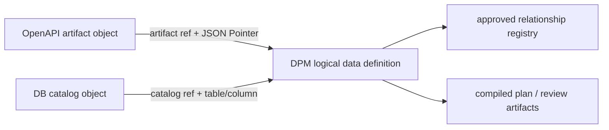

# Goal 68 — DPM Logical Data Definition and Extraction Boundary

**Status: active — 68.0·68.1·68.2·68.3·68.4 private owner acceptance complete; public release and breaking removal remain separately gated**

> Predecessor: [Goal 67 — DPM Canonical Key Typed Encoding v2](./goal-67-dpm-canonical-key-typed-v2.md)<br>
> Architecture boundary: [Package Architecture](../architecture/packages.md)<br>
> DPM baseline: [Relationship-First DPM Roadmap](https://github.com/mineclover/oa-sdk/blob/main/docs/internal/goals/goal-4-dpm-relationship-first-roadmap.md)<br>
> Concept: [Data Pseudonymization Manifest](https://github.com/mineclover/oa-sdk/blob/main/docs/concepts/data-pseudonymization-manifest.md)

## Purpose

DPM already owns logical entities, approved relationships, namespace policy, catalog
evidence, and pseudonymization policy. This goal adds the missing explicit data-field
layer while preserving the boundary between three different object systems:

```text
API artifact object  ── API binding ──> logical DPM data field ── storage binding ──> DB catalog object
```

The goal is not to make OpenAPI or DB catalog a DPM replacement. It is to make the
relationship between their independently identified objects reviewable, versioned, and
extractable to the future external data-governance environment.

Goal 68 owns this contract plane only. Cross-identity search, draft/edit/publish lifecycle,
and authoring convenience are a follow-on control-plane capability after the neutral artifact
is stable; they are not silently included in the Goal 68 compiler scope.

Private owner: [`mineclover/data-governance`](https://github.com/mineclover/data-governance).
The accepted decision is recorded in [owner-decision-record.md](./owner-decision-record.md). The
formal review is recorded in [Goal 68.4 owner acceptance issue](https://github.com/mineclover/data-governance/issues/1),
and the structured owner acceptance form remains available at the current issue/review workflow.
Latest owner CI passed in [workflow 29418892057](https://github.com/mineclover/data-governance/actions/runs/29418892057)
for the selected private source ref with Node.js 25 and pnpm 10.30.3.

## Expressive boundary

DPM owns the logical data contract and the explicit bindings to external evidence. It
does not become a second OpenAPI schema registry or a database migration system.



| Layer | DPM may express | DPM must not express |
|---|---|---|
| Logical data | entity, namespace, field identity, semantic type, nullability, description, derived/computed field | an entire relational schema, arbitrary warehouse ontology, or raw data values |
| Relationship | approved logical parent/child relationship, cardinality, namespace, condition, orphan policy | relationship approval inferred from names or projection shape alone |
| DB catalog | reference to a catalog snapshot and physical table/column evidence | DDL, migration, row rewrite, live credentials, or physical FK mutation |
| API artifact | artifact id, version hash, operation id, JSON Pointer, request/response direction | OpenAPI schema authoring, embedded policy body, or `operationId`-only identity |
| Binding | logical field ↔ API object and logical field ↔ DB object edges | an implicit API ↔ DB edge based on matching names |
| Runtime | compiled-plan inputs, freshness/provenance references, validation/report metadata | vault runtime, token reverse lookup, production execution, or legal anonymization claims |

### Identity and reference rules

- Logical object id, immutable revision id, human-readable locator, binding edge id, and Goal 67
  canonical data-value encoding are different contracts and must not be conflated.
- A published logical DPM field needs a rename-safe object id. Its dataset/namespace/entity/field
  coordinate is a locator and may change through an explicit alias, deprecation, or supersession
  transition. The frozen v1.0 compatibility slice still derives `field:<entity>/<field>`;
  v1.1 carries the explicit object/revision contract.
- An entity name alone is not a globally safe reference. Resolution must include the declared
  dataset and namespace scope; the existing entity identity format is `entity:<namespace>/<name>`.
- A DB object is identified by catalog snapshot identity/freshness plus table and column;
  `table` and `column` without the catalog context are only a human-readable coordinate.
- An API object is identified by artifact id, JSON Pointer, and version hash. `operationId`
  is optional navigation metadata and must not participate in canonical API object identity.
- A draft API binding may carry an unresolved version while being edited, but a published or
  compilable binding must carry and verify its artifact version hash.
- A logical field may have multiple API bindings across artifacts and operations. One
  artifact/version/pointer may bind to at most one logical field unless a future explicit
  projection/alias relation is added.
- A field declares an origin of `persisted`, `derived`, `computed`, or `api_only`. `storage_ref`
  may be absent only for a non-persisted origin. A field that claims to represent persisted DB
  data must carry a resolvable catalog binding.

### Validation levels

| Level | Responsibility | Current state |
|---|---|---|
| Syntax | JSON Schema shape, enums, required properties | Implemented |
| Model-local | identity construction, duplicate fields/bindings, pointer form | Implemented for v1.0/v1.1 |
| Cross-object | entity membership, catalog membership, API pointer/hash/provenance match | Implemented for v1.1 with deterministic DAT diagnostics |
| Compile-time | binding freshness in plan and blocking stale references | Implemented for v1.1; stale or unverifiable bindings block compile |
| Runtime | actual tokenization, vault, row counts, join integrity, post-run report | Outside this goal; existing runtime/storage goals remain authoritative |

## Governance gate

`@oa-sdk/dpm` remains a private, maintenance-only workspace and is now the compatibility/source
implementation for the canonical private `data-governance` owner. This is a compatibility/migration
boundary goal, not an approved new Core Platform feature. The private owner decision records the
release authority, artifact contract, compatibility window, canonical document location, and
rollback rule.

During the compatibility window, only schema compatibility, migration preparation, regression
hardening, and adapter work are in scope. New persisted schemas, cross-repository resolvers,
gateway workflows, search services, and edit/publish workflows remain owner-authorized follow-on
capabilities rather than active monorepo goals.

Goal 68.1–68.4 are canonical in the external owner environment. The monorepo package remains the
source/compatibility implementation until the first accepted owner artifact release (`T1`), then
becomes a forwarding adapter for one subsequent compatibility release.

## 68.0 decision record

The accepted 2026-07-15 owner decision records:

- canonical implementation site: private `mineclover/data-governance`;
- formal release authority: `mineclover` repository owner, with delegated maintainers preparing
  but not unilaterally approving contract/version changes;
- package policy: private, non-published, and outside Core Platform feature scope;
- accepted artifact: `dpm.data-binding-artifact.v1` / `1.0`;
- accepted manifest policy: `data_definitions` `1.0` frozen and `1.1` experimental/deferred;
- compatibility window: first accepted owner artifact release plus one subsequent compatibility
  release, with deprecation notice in the final compatibility release;
- explicit non-goals: public registry publication, breaking removal, production data-plane runtime,
  and the future search/edit/authoring control plane.

Wire compatibility is frozen by version:

| Wire version | Policy | Scope |
|---|---|---|
| `data_definitions` `1.0` | Frozen compatibility contract | Existing structural field, storage, and API binding shape. |
| `data_definitions` `1.1` | Experimental in this monorepo | Namespace-safe logical identity, catalog context, lifecycle, origin, and cardinality rules. |

This decision completes 68.0 and the private 68.4 owner handoff. The private owner is
canonical for the extraction contract, the `mineclover` repository owner is the release authority,
and the compatibility window is the first accepted owner artifact release plus one subsequent
compatibility release. Public registry publication and breaking removal remain separate gates.

## 68.4 private owner repository transition record

The private [`mineclover/data-governance`](https://github.com/mineclover/data-governance) repository
contains the initial extraction, historic owner workflow, and acceptance-form implementation in
its repository history. The latest owner CI
[29418892057](https://github.com/mineclover/data-governance/actions/runs/29418892057) passed build,
typecheck, boundary, owner documentation, tests, and all DPM consumer smokes for the selected
private source ref with Node.js 25 and pnpm 10.30.3.

## Review verdict of the current implementation

| Area | Verdict | Evidence / remaining issue |
|---|---|---|
| Logical ownership | Aligned | DPM already owns `EntityDeclaration`, `LogicalRelationship`, manifest policy, and registry lifecycle. |
| Separate identities | Aligned for v1.1 | `DpmEntityRef`, object id, revision id, locator, binding id, catalog identity, API target identity, and Goal 67 value encoding are separate contracts; v1.0 remains a frozen compatibility shape. |
| API provenance | Aligned for supplied artifacts | Canonical API identity excludes `operationId`; validator verifies artifact hash, pointer, operation, and provenance version; compiled output preserves the API artifact link. |
| DB authority | Aligned for selected catalog | v1.1 `storage_ref` membership, snapshot freshness, and optional source coordinate are validated and propagated into the neutral artifact and plan freshness. |
| Field origin | Aligned for v1.1 | Origin is explicit and model/schema gates enforce persisted storage and non-persisted absence rules. |
| Reverse binding uniqueness | Aligned for v1.1 | Binding edge ids are separate from API target identities and model normalization rejects one artifact/version/pointer target assigned to multiple fields. |
| Wire-version stability | Aligned for temporary execution | `data_definitions` `1.0` is frozen as compatibility; `1.1` is experimental until extraction. |
| Semantic enforcement | Aligned for v1.1 | `validateDpmDataBindings()` participates in validate and compile gates; compiled plan identity includes neutral binding freshness. |
| Core dependency direction | Aligned | New surface stays under DPM; Core packages do not depend on maintenance-only DPM. |
| Extraction readiness | Accepted for private ownership | Private extraction, owner decision record, and CI-backed runtime/declaration/rollback/workflow/pack checks pass; public registry metadata is intentionally deferred. |
| Governance policy | Accepted for private transition | The private owner is canonical, `mineclover` is the release authority, and the compatibility window is recorded in the owner decision record and Issue #1. |

## Roadmap

### 68.0 — Ownership and compatibility freeze ✅

Deliverables:

- record the external DPM repository and private owner decision;
- freeze the `data_definitions` wire version and compatibility policy;
- decide whether the current `1.0` marker is frozen or explicitly experimental before external use;
- define whether `@oa-sdk/dpm` remains a private mirror, becomes an adapter, or is
  extracted;
- add repository/license/publish metadata only when extraction is approved.

Exit criteria:

- one canonical owner and implementation site are named;
- no Core package imports DPM policy types;
- the migration path for `@oa-sdk/dpm/data` imports is documented.

### 68.1 — Identity contract completion ✅

Deliverables:

- use a namespace-safe `DpmEntityRef` rather than an entity name-only reference;
- define a rename-safe logical object id and keep it separate from revision id, human locator,
  binding edge id, DB/API identity, and canonical data-value encoding;
- include dataset and namespace resolution scope in entity/field references;
- extend the DB reference with catalog snapshot identity, freshness hash, and source
  coordinate where available;
- define canonical API object identity as artifact id + version hash + pointer, with
  `operationId` retained only as navigation metadata;
- specify whether a binding identity changes on artifact version changes;
- declare field origin as persisted, derived, computed, or API-only;
- define reverse binding cardinality plus rename, alias, deprecation, and supersession rules.

Exit criteria:

- same-named entities in different namespaces cannot collide;
- same-named entities in different datasets cannot collide when artifacts are indexed together;
- a logical object rename does not silently create an unrelated object or orphan existing bindings;
- DB and API references can be resolved without guessing from a field name;
- changing only `operationId` does not change canonical API object or binding identity;
- identity golden vectors cover dataset/namespace scope, rename, pointer escaping, and version changes.

### 68.2 — Semantic binding validation ✅

Deliverables:

- validate every logical field against a declared DPM entity;
- validate every `storage_ref` against the selected catalog snapshot;
- validate every API pointer against the referenced OpenAPI artifact;
- verify the artifact version hash and, when present, provenance sidecar/source
  coordinate;
- reject one API artifact/version/pointer bound to multiple logical fields unless an explicit
  future projection/alias relation authorizes it;
- enforce persisted-origin/storage binding and non-persisted-origin rules;
- add deterministic `DAT` diagnostics with manifest source pointers and catalog/API
  coordinates.

Exit criteria:

- malformed or stale API/DB references block compile;
- structural catalog evidence remains evidence, not relationship approval;
- approved Relationship Registry semantics remain the only source of relationship
  execution authority.

### 68.3 — Compiler and artifact integration ✅

Deliverables:

- include data-field/API/DB binding references in compiled-plan freshness and output;
- expose a neutral binding artifact that `codegen` can consume without importing DPM
  policy internals;
- make the neutral artifact immutable and sufficient to source a future cross-identity read model
  without coupling search consumers to DPM compiler internals;
- connect source-coordinate/provenance links to behavior trace records;
- add an end-to-end fixture: OpenAPI artifact → API binding → DPM field → catalog column.

Exit criteria:

- a binding is reproducible from artifact ids and hashes;
- API-to-DB direct inference is impossible without an explicit DPM field binding;
- trace and review output can identify all three objects independently.

### 68.4 — Extraction rehearsal

Deliverables:

- build the DPM package from the public subpath contract in a clean consumer fixture;
- test package-name/import compatibility for an external repository;
- define schema/artifact migration and rollback rules;
- move the canonical DPM roadmap and ownership docs to the external environment when
  the owner is confirmed.

The local packed-artifact runtime, declaration, and rollback rehearsal plus the temporary migration/rollback contract are recorded in
[Goal 68 Extraction Migration and Rollback Contract](./goal-68-dpm-extraction-migration.md). The
owner handoff gates are listed in the [Goal 68.4 External Extraction Acceptance Checklist](./goal-68-extraction-acceptance-checklist.md).
The private external rehearsal, owner CI, and formal private owner sign-off are complete. The owner
repository is canonical for the extraction contract. Public registry metadata and breaking adapter
removal remain separately gated.

Exit criteria:

- external consumer smoke passes without monorepo path assumptions;
- old `@oa-sdk/dpm` imports have a documented compatibility window through the first accepted owner
  release plus one subsequent compatibility release;
- the monorepo package can be reduced to a forwarding adapter without changing API/Core ownership.

## Owner-authorized follow-on control plane

After Goal 68.3 produced a stable neutral artifact, the private owner activated one
product-slice-sized control-plane goal through the [Phase 8 private activation decision](./phase-8-decision-record.md).
The current implementation is intentionally definition-scoped and remains private.

Implemented representative slice:

- exact lookup and deterministic filtered search by logical object id/locator, API pointer, DB
  coordinate, semantic type, origin, and lifecycle state;
- reverse API/DB lookup with the matched logical field and its API bindings;
- immutable published revisions, editable drafts, and base-revision optimistic concurrency;
- validate preview, semantic diff, breaking-change classification, rename/deprecation review,
  publish approval, audit readback, and rollback;
- library import, export, identity-only explain, and review-only machine-readable quick-fix suggestions.

Deferred extensions:

- cross-definition/product search and durable broad indexing;
- sensitivity/owner metadata and relationship/policy/trace where-used records;
- automatic mutation and bulk edit;
- PostgreSQL migration/deployment and external authorization integration.

Representative exit criteria:

- one binding can be found from its logical id, API pointer, or DB coordinate;
- published revisions cannot be mutated in place and a stale draft base is rejected;
- breaking changes and rename/deprecation effects are visible before publish, with deterministic
  review-only quick-fix suggestions;
- one public consumer flow proves import/edit/validate/publish/search/audit readback without deep imports.

## Explicit non-goals

- DPM does not become the OpenAPI schema source of truth.
- DPM does not infer API-to-DB mappings from matching names alone.
- Catalog projection does not approve logical relationships.
- Goal 68 does not itself add a searchable registry, editor UI, or draft/publish service; it emits
  the contract and neutral artifact on which the follow-on control plane depends.
- This goal does not add physical DB migrations, token-vault runtime, or production data
  rewrite behavior.

## Current implementation evidence

- `packages/dpm/src/model/data-types.ts` defines logical field, DB column, API object,
  and API binding types.
- `packages/dpm/src/model/data-normalize.ts` provides distinct identity helpers and
  model-boundary checks.
- `packages/dpm/src/model/data-identity-types.ts` defines the experimental v1.1
  namespace/object/revision/locator/origin/lifecycle contract.
- `packages/dpm/src/model/data-identity-normalize.ts` enforces rename-safe identities,
  catalog-qualified storage, API target cardinality, aliases, and supersession rules.
- `packages/dpm/src/schema/dpm-manifest.schema.json` defines the optional
  frozen v1.0 and experimental v1.1 `data_definitions` manifest sections.
- `packages/dpm/src/public/data.ts` and the `@oa-sdk/dpm/data` export establish the
  extraction-oriented public seam.
- `packages/dpm/test/model-data-definition.test.ts` contains identity golden vectors and
  negative cardinality/origin/lifecycle checks; `schema-data-definitions.test.ts` covers
  v1.0/v1.1 schema acceptance and rejection.
- `packages/dpm/src/validator/data-binding-validator.ts` validates v1.1 entity membership,
  catalog freshness/table/column/source coordinates, API artifact hash/pointer/operation,
  provenance version, and reverse binding cardinality with `DAT` diagnostics.
- `packages/dpm/test/validator-data-binding.test.ts` proves valid OpenAPI → DPM → catalog
  resolution, deterministic stale/missing/mismatch blocking diagnostics, immutable neutral
  artifact output, compiled freshness identity, and trace/review links.
- `packages/dpm/src/model/data-artifact-types.ts` defines the policy-neutral artifact, freshness,
  API/catalog provenance, behavior trace, and review link contract.
- `packages/dpm/src/compiler/data-binding-artifact.ts` builds a deterministic deep-frozen artifact;
  `packages/dpm/src/gateway/openapi-execution-plan-data-binding-schemas.ts` keeps the compiled
  output gateway-compatible.
- `packages/dpm/test/package-extraction-smoke.mjs` packages the built DPM artifact, combines it
  with a production dependency tree in a clean temporary consumer, and verifies package-name
  imports without monorepo source paths plus TypeScript declaration consumption from the packed
  public `@oa-sdk/dpm/data` entry point.
- `packages/dpm/test/external-consumer-fixture.mjs` and
  `packages/dpm/test/external-consumer-type-fixture.ts` provide the clean runtime and declaration
  consumer fixtures used by the extraction rehearsal.
- `packages/dpm/test/external-consumer-rollback-fixture.mjs` proves stale rollout rejection, changed
  freshness identity, and rollback from preserved inputs through the packed public package.
- `docs/internal/goals/goal-68-dpm-extraction-migration.md` defines the temporary version,
  compatibility-window, migration, and rollback contract.

## Verification gates

```bash
pnpm --filter @oa-sdk/dpm test
pnpm --filter @oa-sdk/dpm typecheck
pnpm --filter @oa-sdk/dpm smoke:subpaths
pnpm check:api-index
pnpm check:feature-tests
pnpm check:docs
git diff --check
```
